# Phase 2: Network Segmentation and Firewall

## Goal
This phase built a separate network for each part of the lab, plus a firewall connecting them. Each network is sealed off on its own, so any traffic between them has to pass through the firewall, where it can be allowed, blocked, and logged. It also keeps the lab's vulnerable machines away from my real home network.

## Network layout

| Network | Bridge | Subnet | Purpose |
|---|---|---|---|
| WAN | vmbr0 | 192.168.1.0/24 | Home network and internet |
| CORP | vmbr1 | 10.10.10.0/24 | Company machines (targets) |
| SECURITY | vmbr2 | 10.10.20.0/24 | SIEM and monitoring |
| ATTACK | vmbr3 | 10.10.99.0/24 | Kali, the attacker |

## Steps

### 1. Created the lab networks in Proxmox
A bridge works like a virtual network switch: every VM plugged into the same bridge is on the same network. I created vmbr1, vmbr2, and vmbr3 with no IP address, so Proxmox itself isn't on those networks, and no physical port, so they're completely sealed off. The only thing connecting them is the firewall.

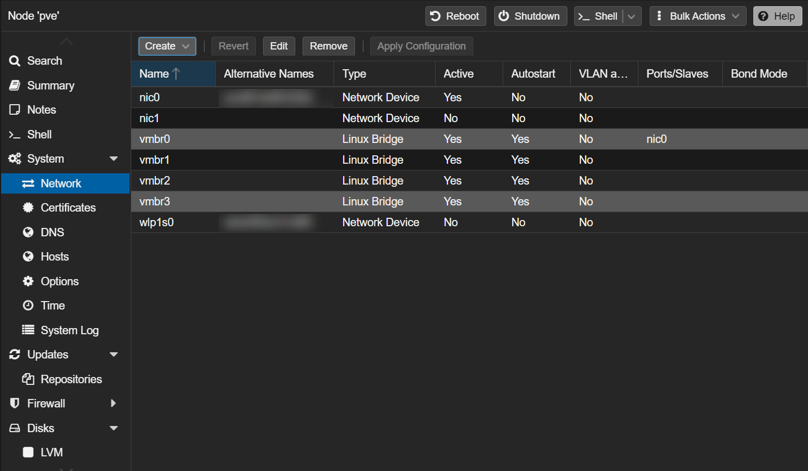

### 2. Built the OPNsense VM
The VM has 2 cores, 2GB of RAM, and a 20GB disk. The installer needed 4GB of RAM, so I raised it for the install and set it back to 2GB afterward. It has 4 network cards so the firewall sits on every network: net0 is the home network (WAN), and the other three are CORP (net1), SECURITY (net2), and ATTACK (net3).

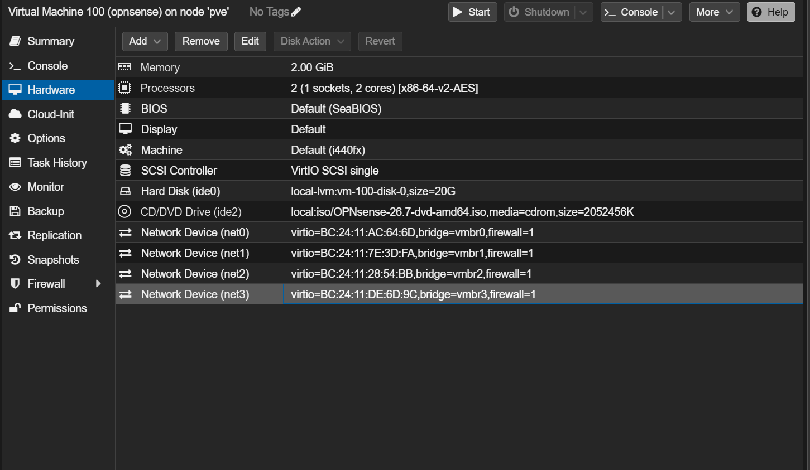

### 3. Installed OPNsense and assigned interfaces
OPNsense lists network cards by MAC address, not by bridge name, so I used the last 2 characters of each MAC to match them up. vtnet0 became WAN, vtnet1 became CORP, vtnet2 became SECURITY, and vtnet3 became ATTACK. Each lab interface got a `.1` address, which is the gateway for that network.

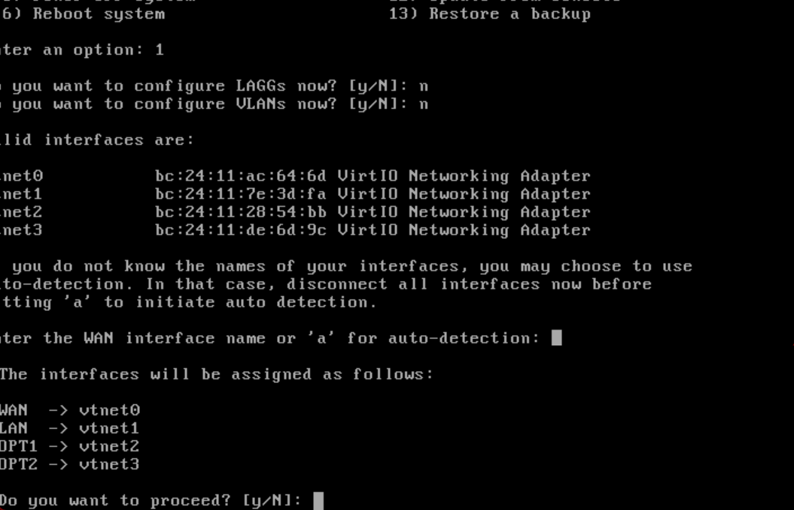
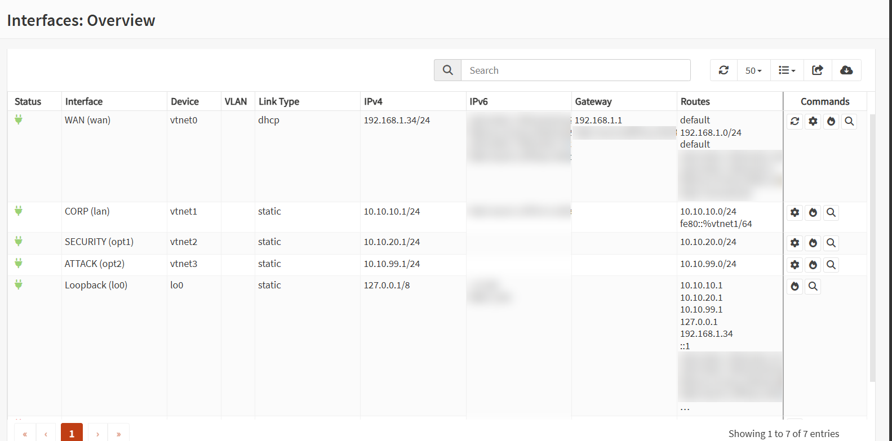

### 4. Wrote the firewall rules
Firewall rules are checked from top to bottom, and the first match wins. So each lab network has 2 rules: first a block rule stopping it from reaching my home network, then an allow rule letting everything else through, like the internet. If the allow rule were on top, it would match first and the block would never run. I also added a rule on WAN that lets my home network reach the firewall's web interface over HTTPS.

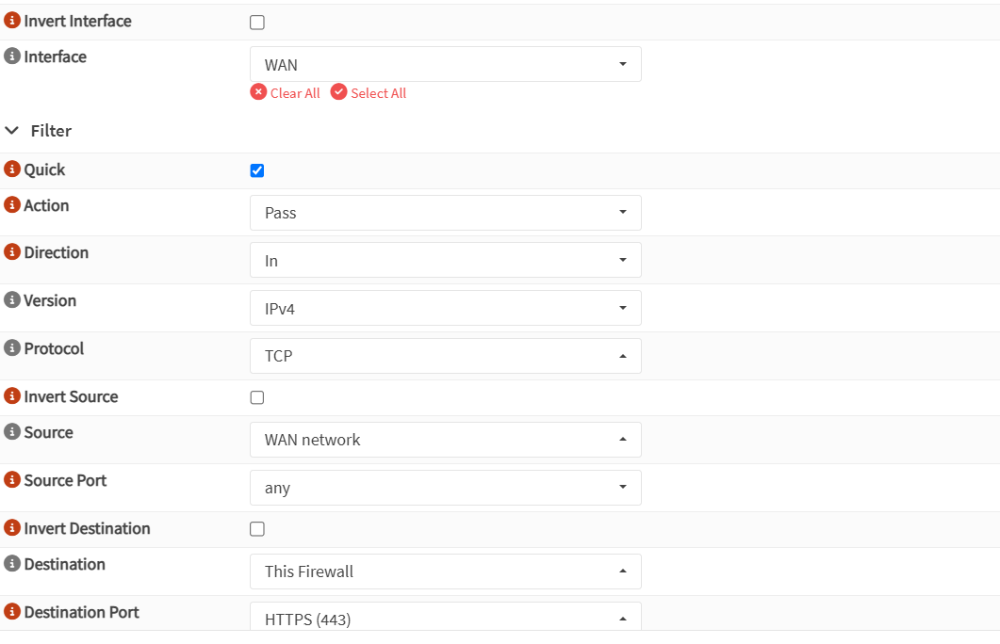
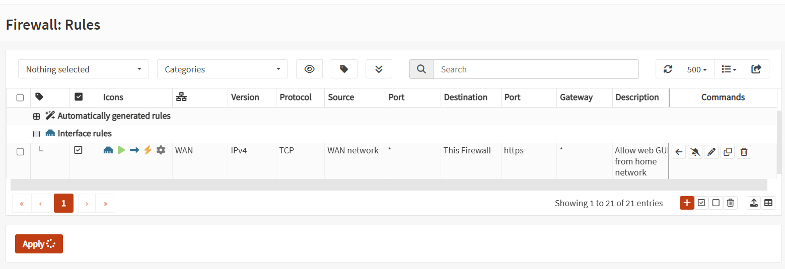

### 5. Tested the isolation
I created a small test container on the ATTACK network and ran ping tests. The firewall, the internet, and DNS all worked, while my home router and Proxmox were both unreachable. A failed ping isn't 100% proof on its own, since a device can just ignore pings. So I checked the firewall's live log, which showed my container's traffic to Proxmox being blocked by my "Block attack from home network" rule.

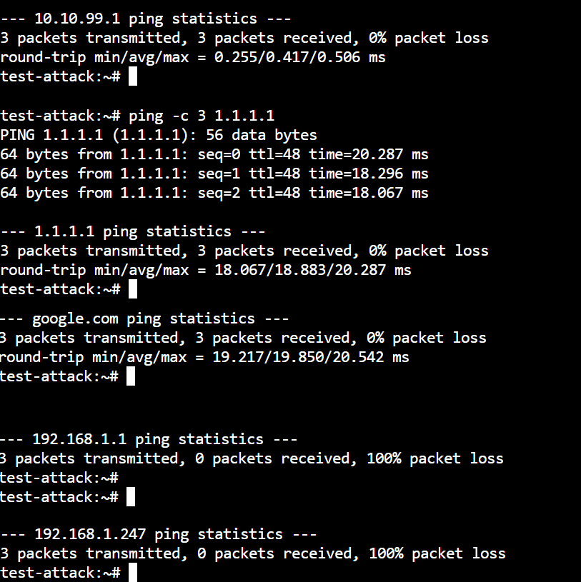
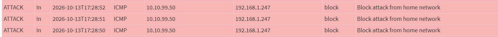

## Problems I hit

### OPNsense took my home router's address
After installing, OPNsense put its LAN on the network card connected to my home network and gave it 192.168.1.1, the same address as my home router. It also runs a DHCP server on LAN by default, so it could have started handing out addresses to devices in my house and knocked the internet offline. Before fixing anything, I disconnected that network card in Proxmox to contain it. Then I reassigned the interfaces from the console, moved LAN to 10.10.10.1, and reconnected it.

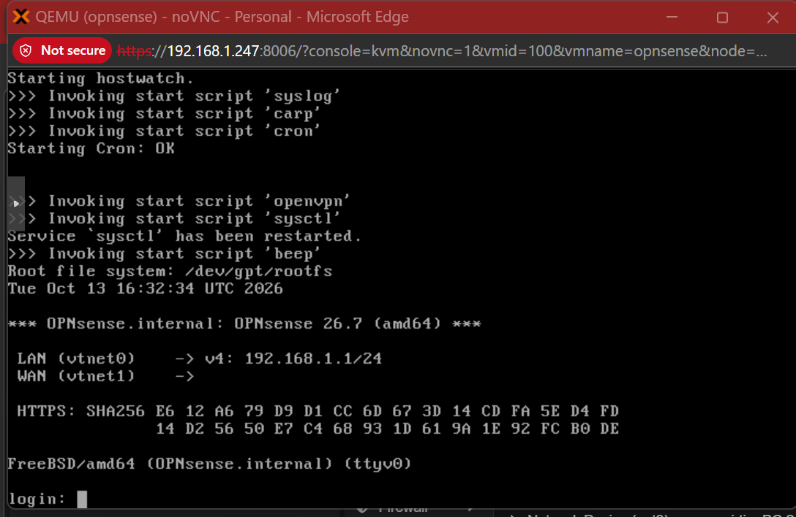

### Couldn't reach the web interface from my laptop
I added a WAN rule allowing my home network to reach the firewall over HTTPS, but the page still wouldn't load. Using `pfctl -sr`, I confirmed the rule was loaded, and the logs showed nothing was being blocked. Reading the raw rule showed the problem: OPNsense had added `reply-to 192.168.1.1`, which sent the firewall's replies to my router instead of back to my laptop. That makes sense for a real internet connection, but my laptop is on the same network as the firewall. I enabled "Disable reply-to" on that rule, then confirmed the fix with the filter turned on and a brand new browser connection.

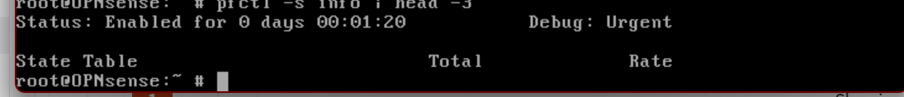
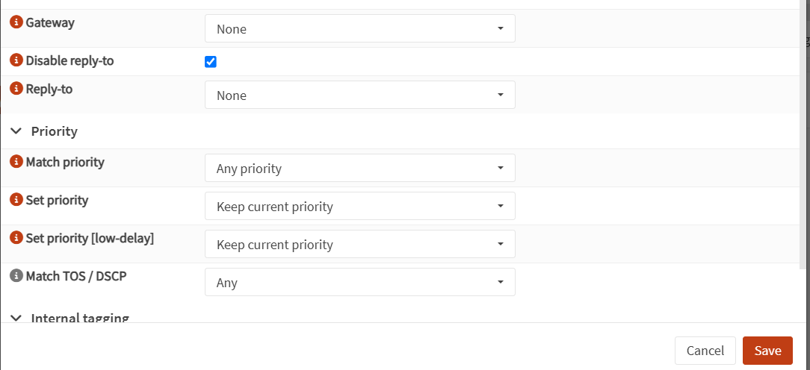

### A rule turned into a floating rule
While creating the network rules, I forgot to select an interface on one of them, so OPNsense made it a floating rule. Floating rules are checked before interface rules, so my "allow corp out" rule would have matched before the corp block rule, letting corp machines reach my home network. I caught it before applying, edited the rule to use the CORP interface, and confirmed the block was above the allow.

## What I learned
- How to troubleshoot a firewall by reading logs and the rules it actually loaded
- Why rule order matters, since the first matching rule wins
- How to reach a separate network from my home network through the firewall
- How to build firewall rules and prove isolation with tests and logs

## Next
Phase 3 will be setting up the SIEM for the lab using Wazuh.
