# Phase 3: Wazuh SIEM

## Goal

A SIEM collects logs from everything in the lab (the firewall, endpoints, servers) and puts them in one place so I can search them and get alerted when something looks like an attack. I wanted it running before any attacks happen, because an attack I can't see teaches me nothing.

## Setup

| Item | Value |
|---|---|
| VM | Ubuntu Server 24.04, 4 cores, 8GB RAM, 60GB disk |
| Network | SECURITY, 10.10.20.10 |
| Wazuh | 4.14, all-in-one install |

## Steps

### 1. Built the Ubuntu server

I checked the ISO's SHA-256 hash against the one Ubuntu publishes before installing, so I knew the file wasn't corrupted or tampered with. I put the VM on the SECURITY network with a static IP of 10.10.20.10 so the firewall always knows where to send logs. I also turned off LVM, because with it on Ubuntu only uses about half the disk by default and I'd have to come back and grow it later.

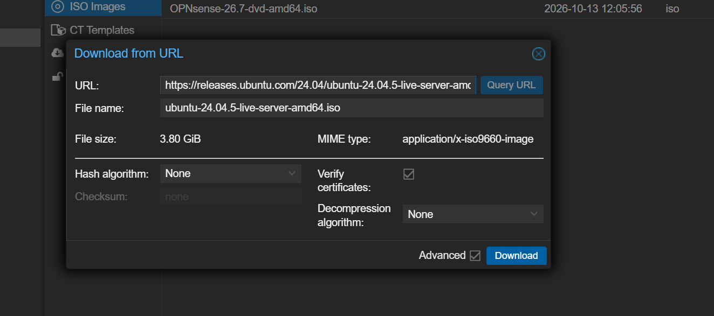
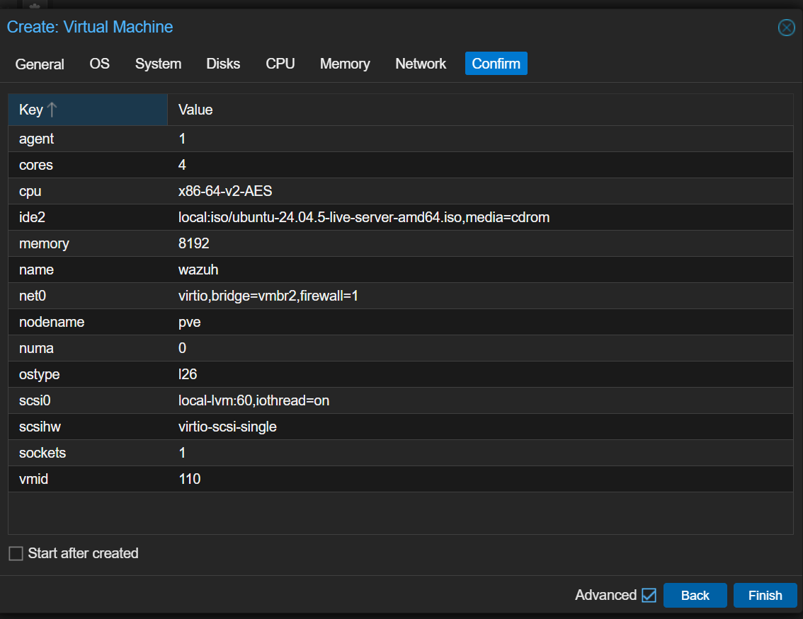
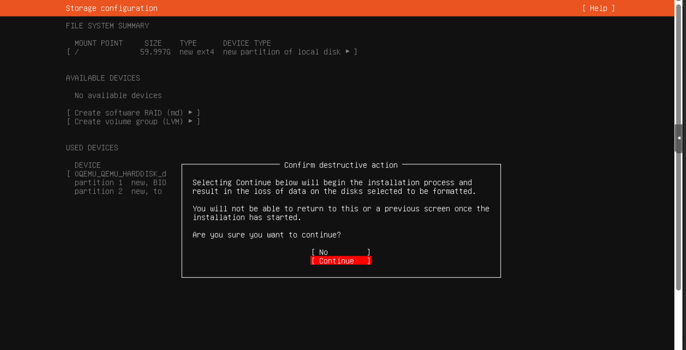

### 2. Installed Wazuh

I ran the all-in-one install, which set up all three parts on one VM: the indexer (stores and searches the data), the server (reads the logs and decides what's an alert), and the dashboard (the web interface).

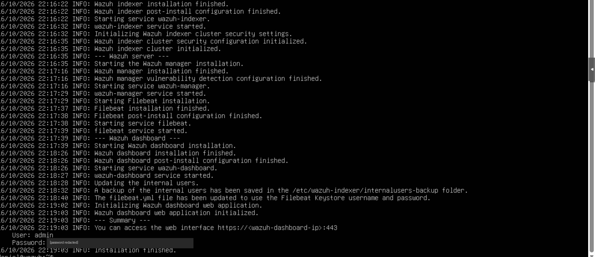

### 3. Reached the dashboard through the firewall

The Wazuh VM sits behind OPNsense, so my laptop on the home network can't reach it directly. I made a port forward so `192.168.1.34:8443` goes to `10.10.20.10:443`. Because of what I learned in Phase 2, I turned on "Disable reply-to" on the rule so replies go back to my laptop instead of getting sent out the wrong way.

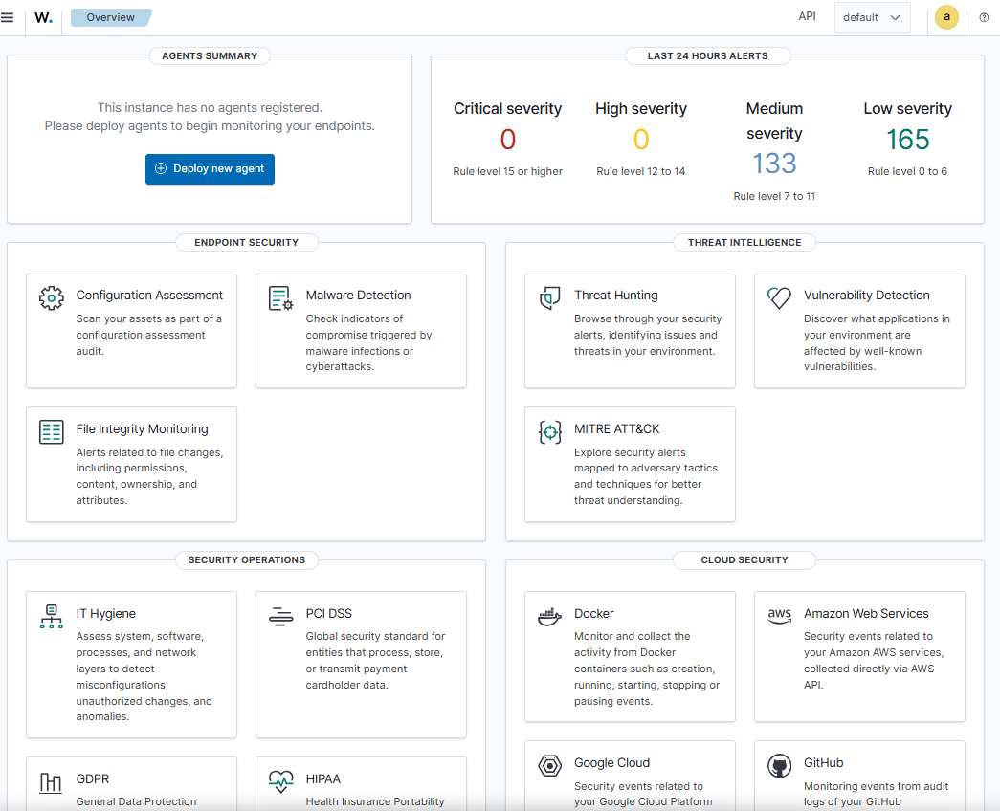

### 4. Sent the firewall's logs to Wazuh

I set OPNsense to send its firewall logs over syslog (UDP 514) to Wazuh, and set Wazuh to only accept syslog from the firewall's IP, 10.10.20.1. Running tcpdump on the Wazuh VM showed packets coming from 10.10.20.1 to 10.10.20.10 on port 514, which proved the logs were actually arriving.

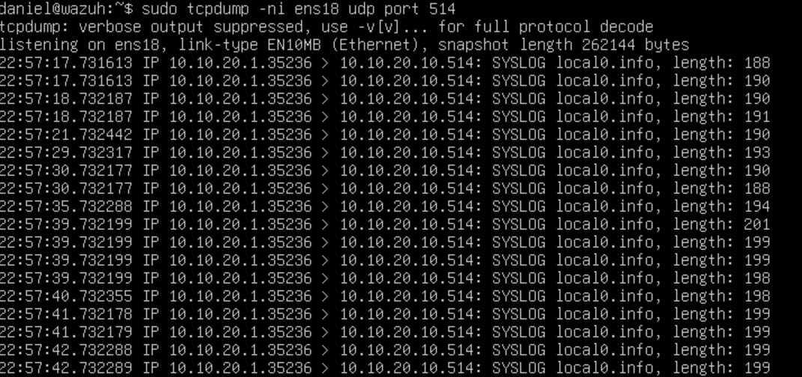

### 5. Wrote a custom decoder and rules

A decoder tells Wazuh how to read a log line. Mine pulls out the important fields from each OPNsense log: the action (block or pass), the interface, the protocol, and the source and destination IPs and ports. Then I wrote three rules on top of it:

- **100100** matches any OPNsense firewall log, level 0 (no alert, just the base).
- **100101** fires when the action is block, level 5.
- **100102** fires when the same source IP gets blocked 15+ times in 30 seconds, level 10. That pattern looks like someone scanning the network, so I mapped it to MITRE ATT&CK **T1046, Network Service Discovery**.

I tested it with wazuh-logtest to make sure it read a real log line correctly before trusting it.

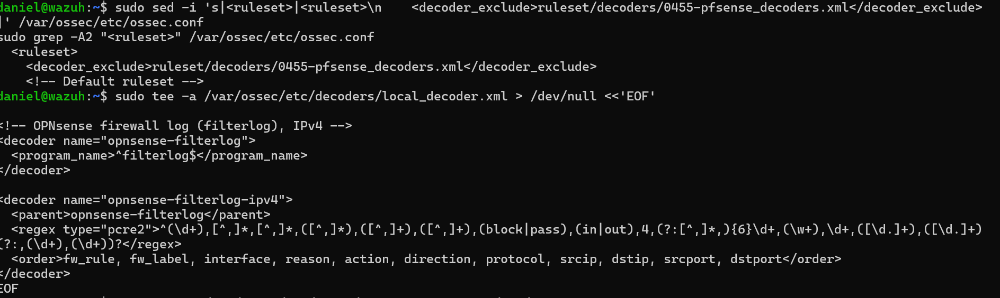
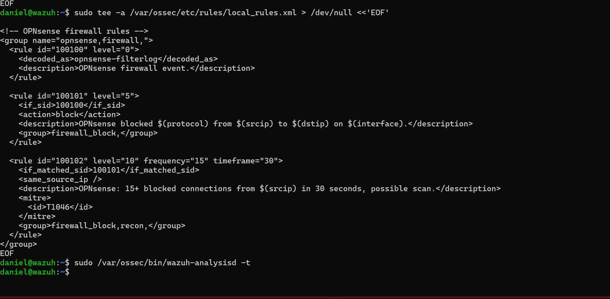
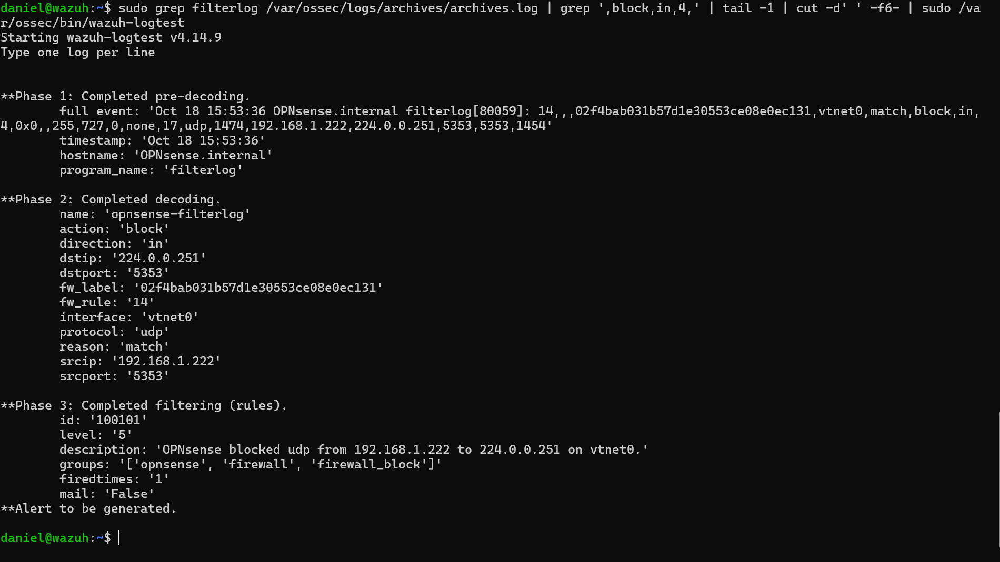

### 6. Tested the detection

From the test container on the ATTACK network I sent a burst of 30 pings at the home router, which the firewall blocks. Wazuh showed 32 block alerts and 1 scan alert, so both rules worked end to end.

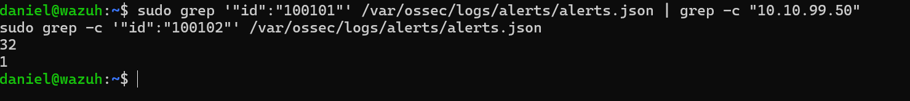
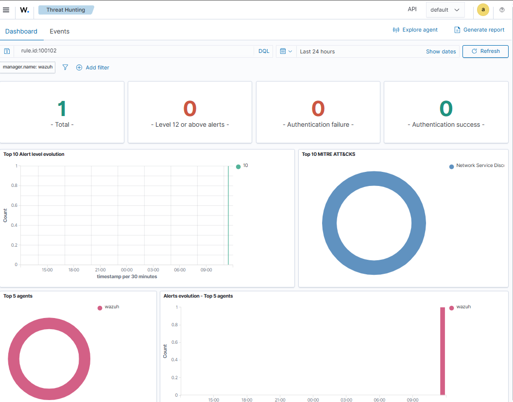
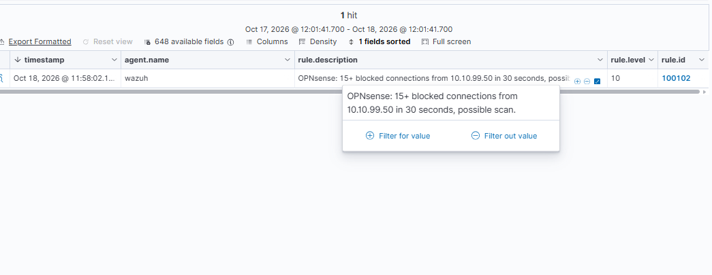

## Problems I hit

### The Ubuntu installer couldn't reach the internet

The installer couldn't download anything, and pings gave "Destination Host Unreachable." The VM's IP and gateway were both set right. The problem was that I'd shut down the OPNsense VM after the last phase, so the gateway at 10.10.20.1 didn't exist and the VM couldn't even find it. Starting OPNsense fixed it. "Start at boot" only kicks in when the whole host boots, not when I shut down one VM myself. Lesson: when a whole network can't get out, check that the gateway is running first.

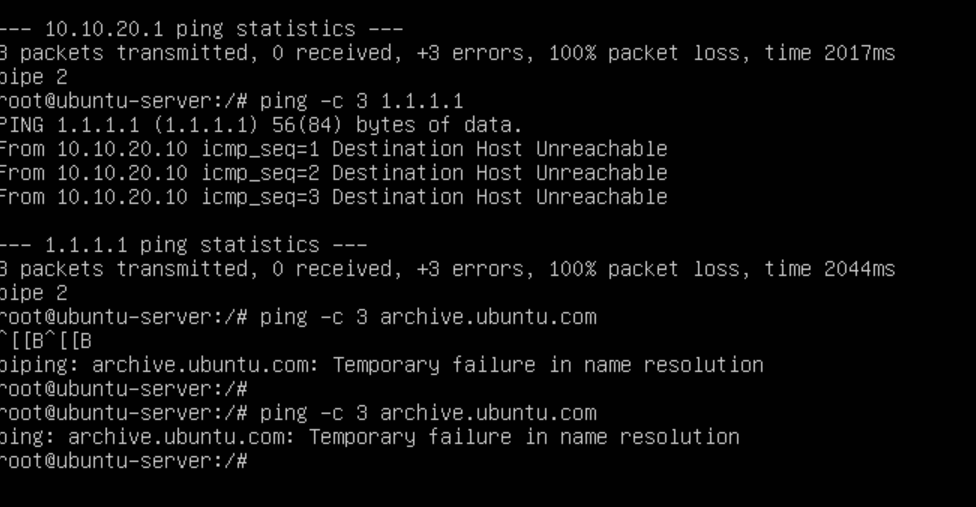

### Firewall logs arrived but never became alerts

This was the big one. tcpdump showed the logs arriving, but nothing showed up in the dashboard. I traced it one step at a time:

1. **tcpdump:** logs were reaching the VM.
2. **Archive:** I turned on full logging and saw Wazuh was receiving and storing them.
3. **wazuh-logtest:** Wazuh's built-in pfSense decoder read the log and said it would alert.
4. **Archive JSON:** the real events were matching rule 87701, so the rule was firing.
5. **alerts.json:** but none of them were ever written as alerts.
6. **analysisd counters:** the `firewall_written` counter was 0, which meant Wazuh was treating these as "firewall" events and sending them somewhere else instead of alerts.

The reason: Wazuh has two different decoders both named `pf`, one for OpenBSD and one for pfSense. Because they share a name they get merged, and the OpenBSD one marks the logs as type "firewall," which changes how Wazuh handles them. logtest doesn't show that, which is why it looked fine there. I excluded the built-in pfSense decoder and wrote my own (step 5) without the firewall type, and the alerts started showing up.

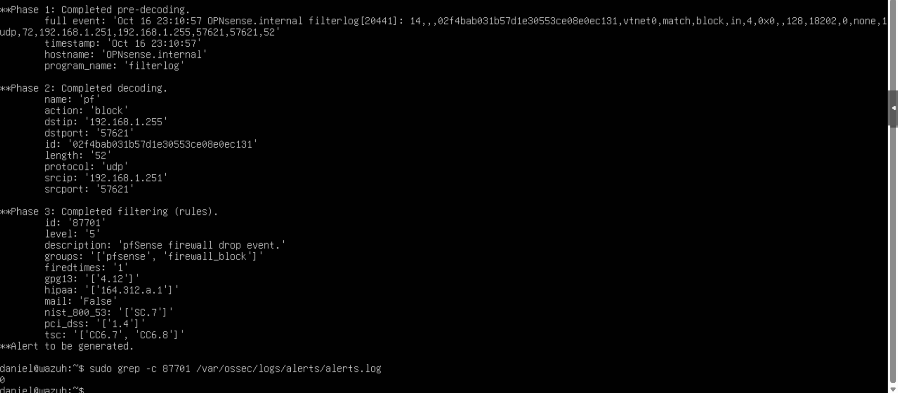
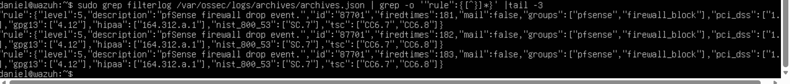
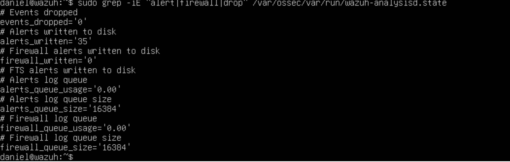
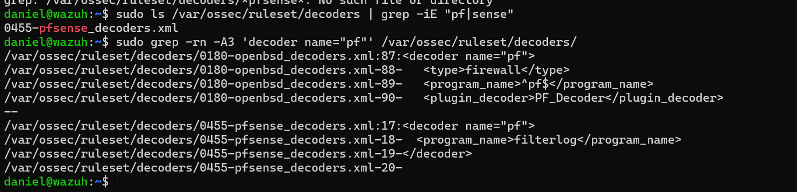

### My search matched my own commands

When I grepped the alerts for 87701, I got 2 hits and thought it was working. They were actually alerts about my own `sudo grep 87701` commands, since Wazuh logs sudo usage and the number was in the command. Lesson: look at what a search actually matched, not just the count.

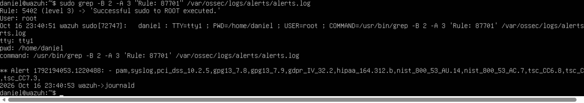

## What I learned

- How to write my own Wazuh decoder and rules, including a frequency rule mapped to MITRE ATT&CK.
- How to troubleshoot a pipeline one step at a time instead of guessing.
- That testing tools like logtest don't always match what happens for real.
- How to use port forwards to reach services behind the firewall.

## Next

Phase 4: put Kali on the ATTACK network, run real attacks like nmap scans, and see what Wazuh catches.
