# Phase 4: Attack and Detection

## Goal
This phase proved the firewall rules and detection rules written in the previous phases. The attack starts from Kali, the traffic passes through the firewall using my rules, then the SIEM watches the logs, detects the attack, and reports it. This ties every part of the lab together.

## What I added this phase

| Machine | Network | IP | Role |
|---|---|---|---|
| corp-target | CORP | 10.10.10.10 | Victim, Ubuntu Server running SSH |
| kali | ATTACK | 10.10.99.10 | Attacker |

## Steps

### 1. Built the target on CORP
I built the target corp-target on a static IP (10.10.10.10) instead of leaving it on DHCP because I wanted the attack path to stay stable. DHCP hands out addresses on leases, and once a lease expires the new address could be different, which would break the path I'm aiming at.

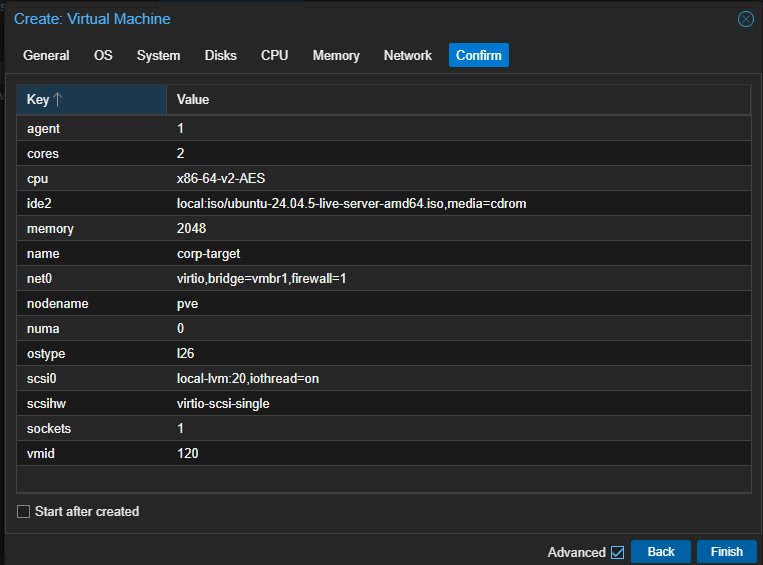
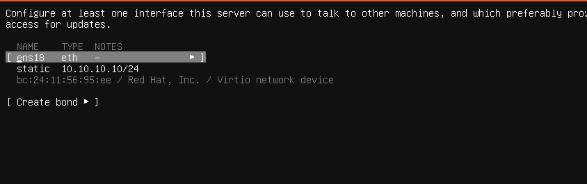

### 2. Confirmed SSH was listening
First I checked the SSH service with systemctl and it came back inactive. Then I ran `ss -ltn`, which lists every TCP socket that's listening, and it showed port 22 open the whole time. This is socket activation: the socket (ssh.socket) is always listening, and the service (ssh.service) only wakes up when a connection actually arrives. That's why the service showed inactive even though the port was open.

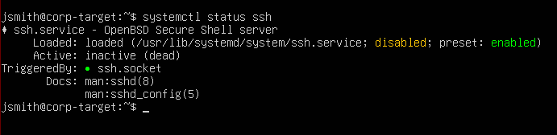
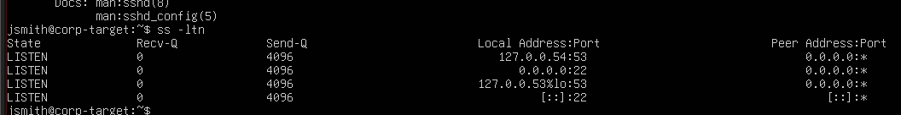

### 3. Built Kali on the ATTACK network
Kali sits on its own subnet instead of the same one as the target because it has to pass through the firewall for the traffic to be seen and logged. If they were on the same subnet, they'd talk directly and none of the attack traffic would be detected.

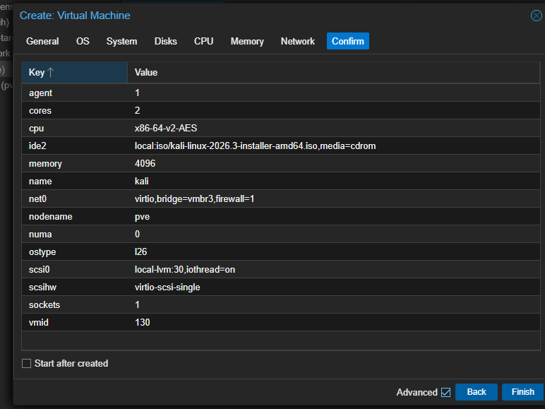

### 4. Verified the attack path through the firewall
First I pinged the gateway (10.10.99.1) from Kali and it answered directly with a TTL of 64, meaning the packet didn't cross any router. Then I pinged the target (10.10.10.10) and the reply came back with a TTL of 63, which means it crossed exactly one router, OPNsense, on the way. That one-hop drop confirmed the traffic actually routes through the firewall. I didn't need to add a new firewall rule because my Phase 2 block-then-allow setup already blocks lab-to-home and allows everything else, and ATTACK reaching CORP counts as "everything else," so it was already permitted.

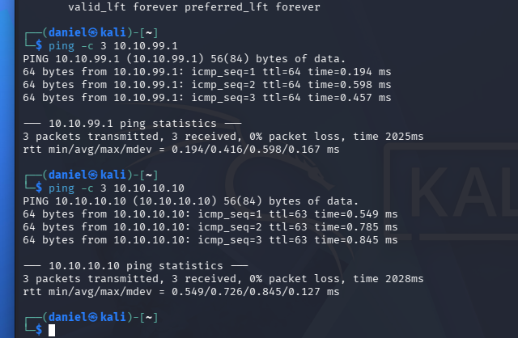

### 5. Installed the Wazuh agent on the target
I installed the Wazuh agent on the target, which turns it into a monitored endpoint. The agent reads the target's own logs and forwards them to the Wazuh manager on the SECURITY network. During install I set `WAZUH_MANAGER` to 10.10.20.10, which tells the agent where the manager lives so it knows where to send everything. On startup the agent self-registered, meaning it reached out to the manager on its own, got a unique ID and key, and uses that key from then on to prove it's really itself. This is the big step up from Phase 3: back then I only had the firewall's logs, and now I'm collecting logs straight from the endpoint, which is a real SIEM capability.

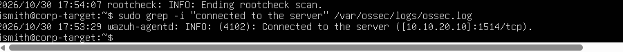

### 6. Ran the brute force from Kali
Hydra is a password cracker in Kali that runs a brute-force attack using a wordlist. I used a short list with the correct password as the last entry so it would crack quickly instead of running for days like rockyou.txt would. As expected, hydra blew through the wrong passwords and succeeded on the final attempt, printing the login it cracked.

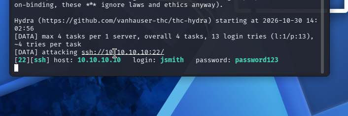

### 7. Detected the attack in Wazuh
The SIEM caught the attack in three tiers. Each individual failed login was tagged rule 5760. Then the SIEM correlated that burst of failures into rule 5763, a brute force at level 10 (mapped to MITRE T1110). Finally, after I got in, it raised rule 40112 at level 12, which means the failures ended in a success, so the attacker actually breached the box. 40112 is the scariest alert here because it's not just an attempt, it's a confirmed break-in.

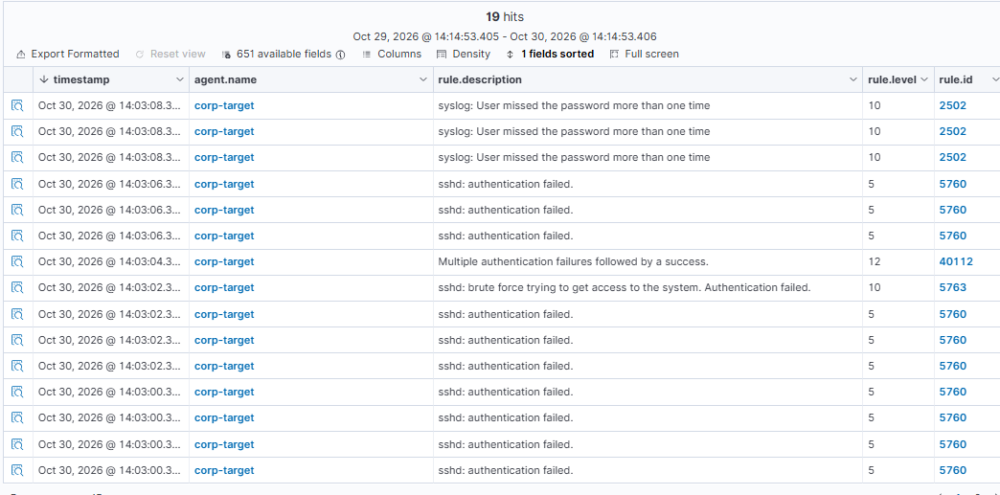
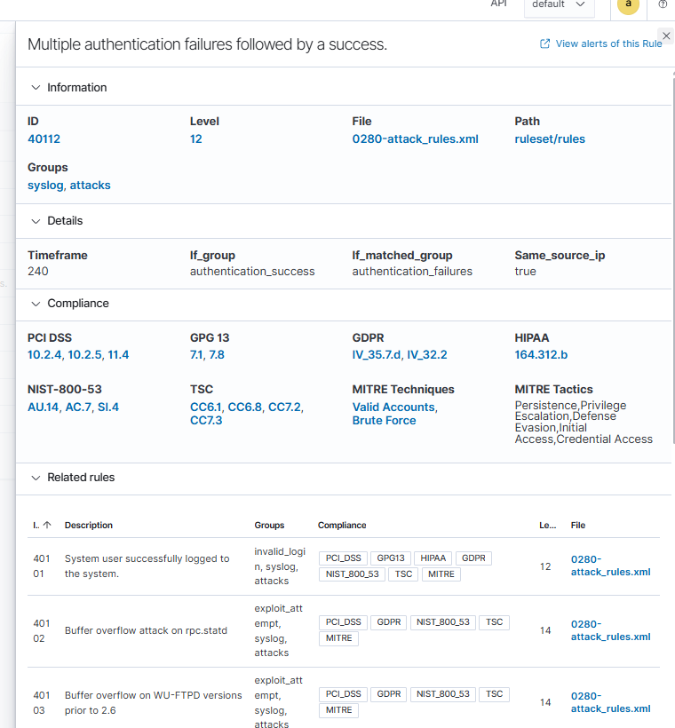

## Problems I hit

### Searching for the wrong rule ID
I searched the SIEM by rule.id 5712, which I guessed was the brute-force rule, and got nothing. The lesson: don't hunt by a rule number you're guessing at. I searched by the source IP of the attacker instead, and all the alerts showed up. Hunt by behavior or source, then read which rules actually fired.

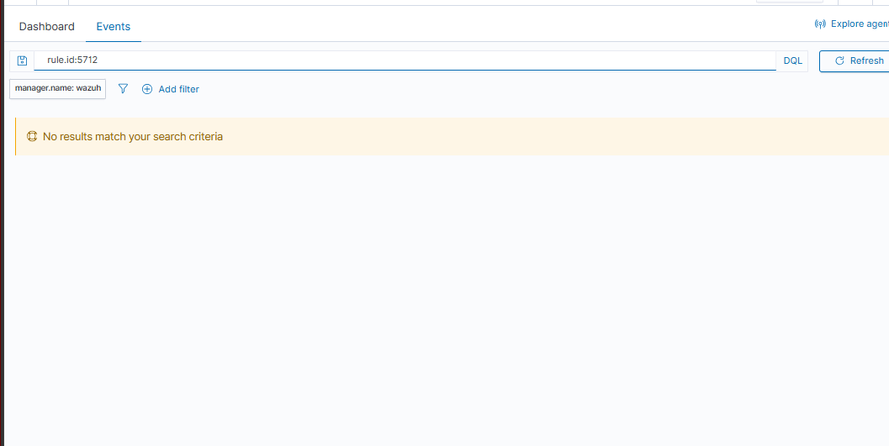

## What I learned
I learned the full attack-to-detection loop, which is the foundation of this lab and what a SOC does. Kali attacks the target, the target writes down every failed login, the Wazuh agent I installed today forwards those to the SIEM, the SIEM reads the logs and figures out what they mean, and the alerts plus the SIEM's verdict show up in the Wazuh dashboard.

I also learned that the SSH socket stays listening at all times, while the service stays inactive until traffic arrives, at which point the service wakes up and handles the connection.

## Next
Phase 5: build a small Active Directory domain on CORP, attack it (Kerberoasting, password spraying), and write detection rules for each.
